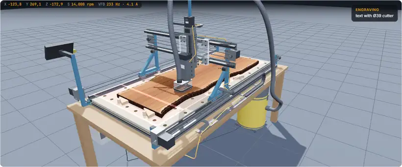
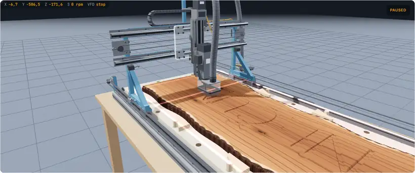
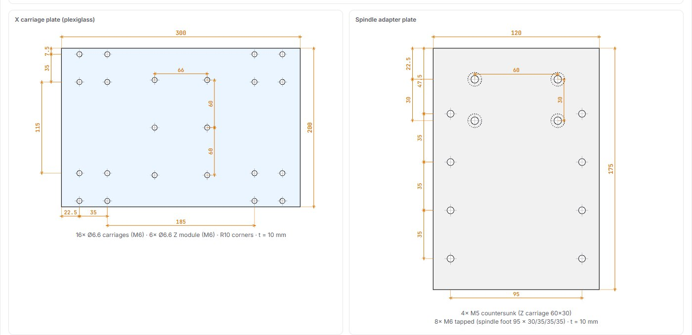
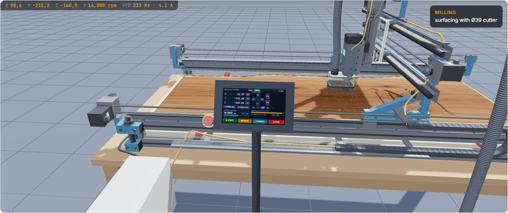
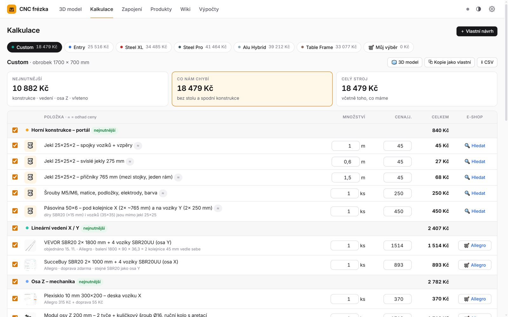
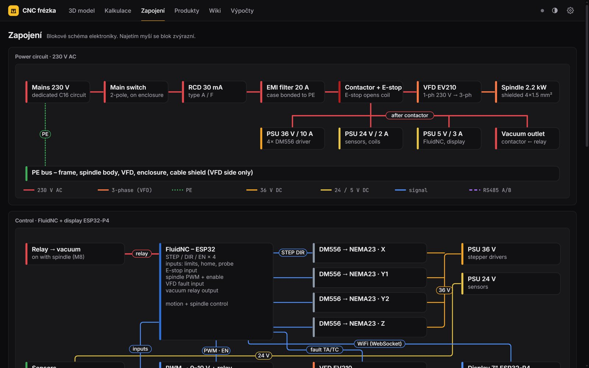
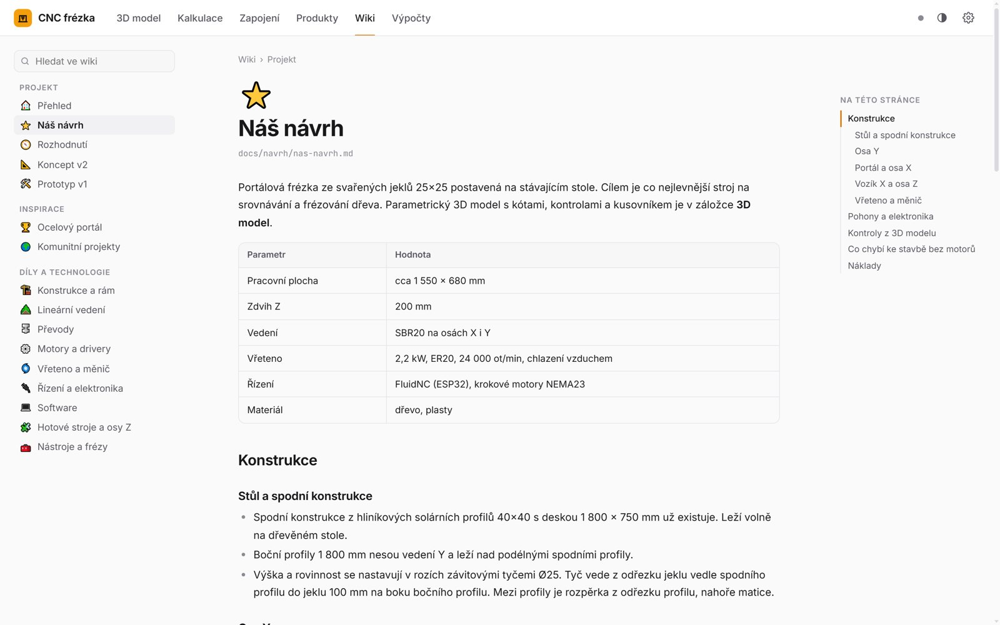
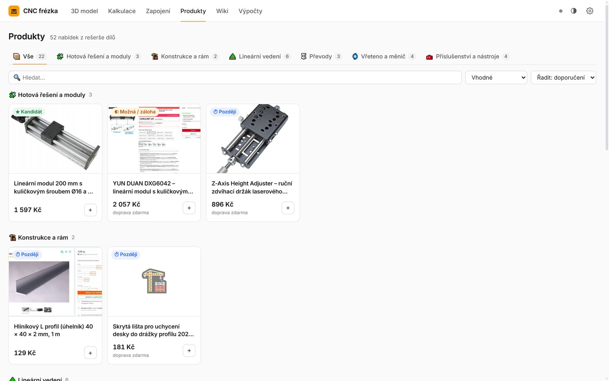
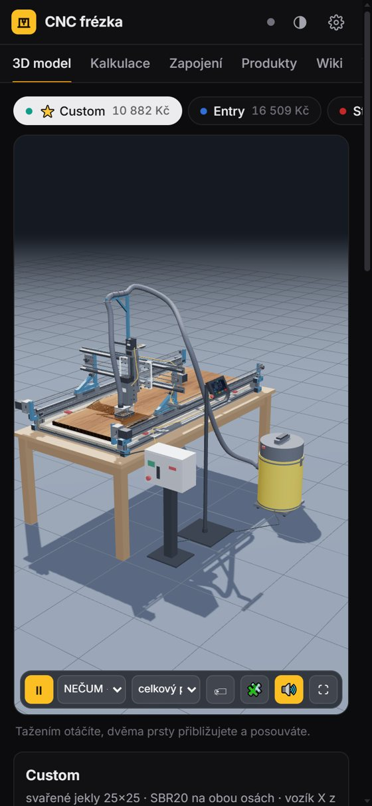

<div align="center">

# DIY CNC frézka

**Interaktivní 3D plánovač stavby portálové CNC frézky**<br>
model podle skutečných rozměrů dílů · animace frézování · kalkulace · schémata zapojení · dokumentace

[](https://zbynekpecina.github.io/diy-cnc-frezka/)
[](LICENSE)


<br>



</div>

<br>

Stavíme levnou portálovou frézku na dřevo a celý návrh vzniká v prohlížeči. Model se skládá z primitiv three.js podle skutečných rozměrů dílů: rozteče děr kolejnic SBR20, výšky vozíků, příruby NEMA23, patky vřetena. Při změně parametru se přepočítá geometrie, kontroly pojezdů i kusovník s cenami.

Celá aplikace je **jeden HTML soubor bez frameworku**. Funguje offline, na mobilu i ve světlém a tmavém motivu.

## Co umí

<table>
<tr>
<td width="50%" valign="top">

### 3D model
- celý stroj podle skutečných rozměrů, s popisky dílů a kótami
- **animace** – stroj se postaví krok za krokem, vygravíruje nápis a srovná desku: odebírání materiálu v reálném čase, třísky, odsávání, zvuk vřetena
- **rozložený pohled** sestav a postup stavby krok za krokem
- pohledy kamery: celek, osa Z, vozíky, elektronika, displej

</td>
<td width="50%" valign="top">

### Návrh a kalkulace
- parametry (kolejnice, stojky, příčníky, plexisklo, zdvih Z) jdou měnit i kliknutím na kótu
- kontroly: pojezdy, ponor frézy, světlost, šířka frézování
- kusovník s cenami, odkazy do obchodů a náhledy dílů
- **výrobní výkresy a řezný plán** – délky jeklů a pásovin, úhel vzpěry, díry v plexiskle, adaptéru a pásovinách
- **pracovní oblast** vyznačená laserem podle skutečného dosahu nástroje
- varianty Custom a Custom2 a pět dalších konceptů pro srovnání

</td>
</tr>
<tr>
<td valign="top">

### Elektronika
- blokové schéma: silová část 230 V, řízení FluidNC, svorky měniče
- RS485 Modbus mezi displejem ESP32-P4 a měničem EV210
- SVG generované z dat, poznámky k zapojení

</td>
<td valign="top">

### Dokumentace
- wiki z Markdownu: návrh, rozhodnutí, rešerše dílů
- katalog 50+ nabídek s cenami a fotkami
- výpočty: průhyb, kritické otáčky šroubu, kroky na mm, řezné podmínky

</td>
</tr>
</table>

## Ukázky

<div align="center">



<sub>Rozložený pohled: vozík X, modul osy Z a vřeteno se rozloží na jednotlivé díly a šrouby</sub>

<br><br>



<sub>Výrobní výkresy: díry v plexiskle vozíku X a v adaptéru vřetena, počítané z parametrů návrhu</sub>

<br><br>



<sub>Ovládací displej 7" ESP32-P4 s živými hodnotami z měniče</sub>

<br><br>

| Kalkulace | Zapojení |
|:---:|:---:|
|  |  |
| **Wiki** | **Produkty** |
|  |  |



<sub>Mobilní zobrazení v tmavém motivu</sub>

</div>

## Spuštění

### Bez instalace

Otevři **[živou ukázku](https://zbynekpecina.github.io/diy-cnc-frezka/)**. Úpravy se ukládají do prohlížeče a jdou exportovat v Nastavení.

### Lokálně

```bash
pip install -r requirements.txt     # Pillow, numpy, scipy – jen pro náhledy obrázků
python tools/build.py               # src/ + docs/ → web/index.html
```

Hotový `web/index.html` jde otevřít přímo z disku. Bez knihoven z `requirements.txt` se sestaví také, jen bez zmenšených náhledů.

### Server se sdíleným stavem

Pro více zařízení nebo uživatelů je v `tools/server.py` server bez závislostí:

```bash
python tools/server.py --no-auth                      # lokálně bez hesla, http://127.0.0.1:8090
python tools/server.py --set-password                 # heslo pro úpravy (ukládá se jen hash)
python tools/server.py --set-password --role viewer   # volitelné heslo jen pro prohlížení
python tools/server.py                                # s přihlášením
```

- stav v `data/state.json`, souběžné úpravy z více zařízení server sloučí
- hesla jako PBKDF2-SHA256, podepsaná HttpOnly cookie, omezení počtu pokusů, kontrola Originu
- za reverzní proxy (Cloudflare tunel, nginx) spouštět s `--trust-proxy`

### Docker

```bash
cp .env.example .env                 # nastav CNC_PASSWORD
docker compose up -d --build         # http://localhost:8090
```

Obraz sestaví web v build stage a běží jako neprivilegovaný uživatel. Stav a hash hesla jsou ve svazku `/data`.

## Struktura

```
src/
  index.html          kostra stránky
  css/                tokeny, rozvržení, komponenty, stránky
  js/                 aplikace (3D scéna, návrh, kalkulace, wiki, schémata…)
  vendor/             three.js r128, OrbitControls, marked
docs/                 wiki a katalog dílů v Markdownu
tools/
  build.py            sestaví web/ (vše inline do jednoho HTML)
  server.py           volitelný server: sdílený stav a přihlášení
Dockerfile, docker-compose.yml
.github/workflows/    sestavení a nasazení na GitHub Pages
```

| Kde co v kódu najít | Soubor |
|---|---|
| parametry, kontroly a kusovník návrhu | `src/js/design.js` – `NAS_DEF`, `nasCalc`, `nasChecks`, `bomNas` |
| 3D scéna, geometrie stroje, animace | `src/js/viewer3d.js` – `buildNas`, `sbrRail`, `nema23`, `tickCut` |
| alternativní koncepty | `src/js/variants.js` |
| schémata zapojení | `src/js/wiring.js` |
| ukládání a synchronizace | `src/js/core.js` |

## Stroj

| | |
|---|---|
| Konstrukce | svařené jekly 25×25 na stávajícím stole |
| Pracovní plocha | cca 1 550 × 680 mm, zdvih Z 200 mm |
| Vedení | SBR20 na osách X i Y |
| Vřeteno | 2,2 kW ER20, 24 000 ot/min, měnič EV210 s RS485 |
| Řízení | FluidNC (ESP32), NEMA23 + DM556, displej 7" ESP32-P4 |

Podrobnosti jsou ve [wiki](docs/README.md). Model slouží k plánování. Rozměry před vrtáním a řezáním ověř na skutečném dílu.

## Licence

Kód je pod licencí [MIT](LICENSE). Knihovny three.js a marked mají vlastní licenci MIT. Obrázky produktů v `docs/` jsou zmenšené náhledy ze stránek prodejců a slouží jen k identifikaci dílu.
