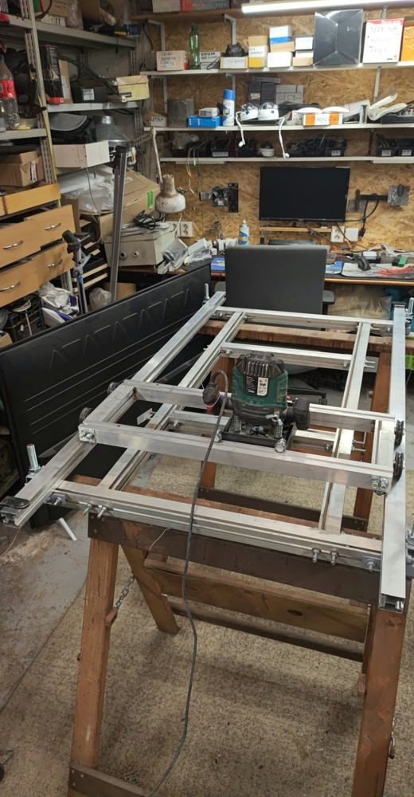

# Prototyp v1

Výchozí stav před přestavbou: ručně posouvaný rám s horní frézkou. Stránka popisuje konstrukci, příčiny nepřesnosti a co z prototypu lze použít dál.

> **Aktuální stav (15. 11. 2026):** Nový stroj podle [Našeho návrhu](nas-navrh.md) se staví na stávající spodní konstrukci z Al solárních profilů 40×40 s deskou 1800 × 750 mm na dřevěném stole. Výška se rovná závitovými tyčemi Ø25.

## Konstrukce

| Část | Řešení |
|---|---|
| Podstavec | dřevěné kozy (dva stojany ze dřeva) |
| Rám | tenkostěnné hliníkové jekly a L profily spojené jednotlivými šrouby, výška nastavitelná závitovými tyčemi M10 |
| Pojezd Y | vozík na kolečkách s drážkou (černá plastová kladka) jezdící po hraně hliníkového jeklu |
| Pojezd X | druhý rámeček s kolečky, jezdí po jeklech uvnitř vozíku Y |
| Osa Z | ruční horní frézka Parkside (ponorná, s pružinami) upnutá na podložku; hloubka se nastavuje ponorem frézky |
| Pohon | ruční |
| Pracovní plocha | odhad cca 0,7–0,8 × 1,6–1,8 m (ověřit měřením) |

## Příčiny nepřesnosti

1. **Kolečka po holém hliníkovém jeklu.** Jekl není broušená dráha: má zaoblené hrany a odchylku přímosti v desetinách milimetru na metr. Plastová kolečka pod tlakem pruží a v měkkém hliníku vyjíždějí stopu. Bez excentrického předpětí mají vůli.
2. **Nízká tuhost nosníků na dlouhém rozpětí.** Tenkostěnné jekly délky 1,6–1,8 m se prohýbají pod vahou frézky i pod řeznou silou. Průhyb roste se třetí mocninou délky.
3. **Rámečky nejsou zaúhlované.** Spoj s jedním šroubem funguje jako kloub. Bez diagonál nebo spojovacích desek se rámeček deformuje do kosodélníku a vozík se kroutí a stáčí.
4. **Dřevěné kozy jako základ.** Dřevo pracuje s vlhkostí, kroutí se a kozy nejsou v rovině. Dvě nezávislé kozy neudrží obě vodicí dráhy rovnoběžně a ve stejné výšce.
5. **Ponorná frézka s pružinami jako osa Z.** Ponorné sloupky mají vůli a pružiny tlačí nahoru, takže hloubka řezu se mění se zatížením. Frézka má navíc větší házivost než vřeteno.
6. **Ruční posuv.** Nerovnoměrná síla ruky způsobuje kmitání a mění hloubku řezu.

## Další využití dílů

| Díl | Využití |
|---|---|
| Frézka Parkside | dočasně na osu Z, než bude k dispozici vřeteno; potom jako ruční nářadí |
| Hliníkové jekly a L profily | kryty proti prachu, vedení kabelů, držáky odsávání, přípravky. **Ne na nosnou konstrukci.** |
| Závitové tyče a šrouby | montážní přípravky, nivelační nohy |
| Kolečka | nepoužívat |
| Kozy | odkládací stůl nebo dočasná opora při stavbě nového rámu |

## Poučení pro nový návrh

- Tuhý **rám jako jeden celek** (svařovaný nebo šroubovaný ocelový rám na vlastních nohách), ne volné díly na kozách.
- **Lineární vedení** (SBR20 nebo HGR20) přišroubované na **rovné a rovnoběžné** plochy místo koleček.
- **Spoje zaúhlované** deskami nebo svarem, žádné spoje s jedním šroubem.
- **Pevná osa Z s kuličkovým šroubem** a pevně přišroubované vřeteno místo ponorné frézky.
- Rozměry stanovit podle největšího obrobku (desky, river table) a stroj nezvětšovat zbytečně: každý metr navíc snižuje tuhost.
